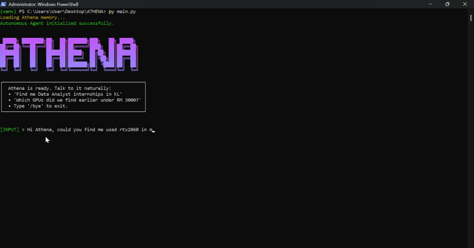
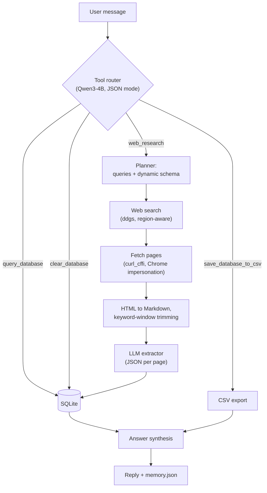

# Athena: A Local-First Autonomous Research Agent

> Ask in plain English. Athena plans the search, scrapes the web, extracts structured data with a **local 4B-parameter LLM**, stores it in SQLite, and answers follow-up questions from what it found. No API keys, no cloud, no per-token costs.




Athena is a **universal** search tool: the same pipeline finds internships, used GPUs, prayer times, or anything else you can describe, because the LLM designs the data schema for each request instead of relying on hard-coded fields.

```text
[INPUT] > Find me Data Analyst internships in KL
[INPUT] > Which GPUs did we find earlier under RM 3000?
[INPUT] > Check what we saved about internships, then search for new AI ones
[INPUT] > Export the internships to CSV
```

---

## Why this project exists

I wanted a research assistant I fully control, one that runs on a **CPU-only, 16 GB RAM laptop** with a 4B model quantized to Q4. That constraint shaped most of the design: every token sent to the model costs real seconds, so the engineering focus is on **giving a small model exactly the right context** and **keeping its output structured and verifiable**.

## Highlights

| Area | What it does |
|---|---|
| **Local-first LLM** | Runs `qwen3:4b-instruct-2507-q4_K_M` through the Ollama HTTP API. Fully offline except for web search and page fetching. |
| **LLM tool router** | A routing prompt (JSON mode) picks one or more tools per message and executes them in order, e.g. `query_database` → `web_research`. |
| **Dynamic schema planner** | For each request the model returns search queries, an `entity_name`, and a custom field schema. One pipeline handles very different domains. |
| **Context-budget engineering** | Pages are converted HTML → Markdown, reference links are inlined, then a **keyword sliding-window trimmer** (N lines before / M lines after each hit, merged into blocks, capped at a character budget) keyed on terms from the search queries feeds the model only the relevant listing cards. |
| **Anti-bot-aware scraping** | `curl_cffi` with Chrome TLS impersonation; Cloudflare/403 challenge pages are detected and skipped instead of being "extracted". |
| **Prompt-injection hygiene** | The extractor treats webpage text as untrusted data, never as instructions, and is told to return `null` rather than invent missing values. |
| **Data layer** | SQLite with `UNIQUE` constraints, tracking-parameter stripping, relative → absolute URL resolution, site-specific link cleaning, and fuzzy de-duplication at query/export time. |
| **Conversation memory** | Chat history persists to `memory.json`; each answer uses the system context plus the most recent turns to stay inside the context window. |
| **Grounded answers** | Replies are synthesized from tool results (database rows or freshly scraped data), not from the model's memory. |

## How it works



**A research run, step by step**

1. **Route:** the router reads your message plus the last few turns and returns a JSON plan of tools to run.
2. **Plan:** for `web_research`, the planner turns your request into 2-3 short search queries, an entity name (e.g. `gpus`), and the fields to extract.
3. **Search and fetch:** DuckDuckGo results are collected and each page is fetched with browser impersonation.
4. **Trim:** the page is reduced to the parts that matter to the request.
5. **Extract:** the LLM returns JSON matching the planned schema, which is saved to SQLite page by page.
6. **Answer:** Athena responds from the stored/scraped data.

## Design decisions worth knowing about

- **Short, broad search queries.** Long, over-constrained queries (exact dates, years, many requirements) tend to return zero results, so the planner is told to keep queries to 2-4 words. Specifics are then matched on the page itself by the trimmer.
- **Trim before you prompt.** On a small local model, prompt length is latency. Windowed trimming keeps each extraction call small and focused.
- **Schema per request, constants in code.** `item_name_or_title`, `provider_or_company` and `link` are always required so results can be de-duplicated and linked, while the remaining fields are invented per request.
- **Defensive by default.** Unreadable or blocked pages are skipped, JSON parse failures fall back safely, and the model is instructed never to fabricate sellers or links.

## Getting started

### Prerequisites

- **Python 3.12+** (the code uses nested same-type quotes inside f-strings, which need 3.12)
- **[Ollama](https://ollama.com/)** installed and running
- Roughly 4 GB of free RAM for the model (16 GB total recommended)

### Install

```bash
git clone https://github.com/<your-username>/<your-repo>.git
cd <your-repo>

python -m venv .venv
# Windows:
.venv\Scripts\activate
# macOS / Linux:
source .venv/bin/activate

pip install -r requirements.txt
```

### Pull the model

```bash
ollama pull qwen3:4b-instruct-2507-q4_K_M
```

Make sure Ollama is running (the desktop app, or `ollama serve`).

### Run

```bash
python main.py
```

Talk to it naturally. Type `/bye` to exit.

On first run Athena creates `athena_research.db` (scraped data) and `memory.json` (conversation history) next to the script.

### Things you can say

| You say | Tool used |
|---|---|
| "Find me AI internships in Selangor" | `web_research` |
| "Which GPUs did we find earlier?" | `query_database` |
| "Check the database for internships, then search for new ones" | `query_database` → `web_research` |
| "Export the GPUs to CSV" | `save_database_to_csv` (writes `<entity>.csv`) |
| "Clear all internship records" | `clear_database` |

## Configuration (manual, for now)

> **Heads-up:** an in-app settings configurator is planned but **not implemented yet**. If you fork this repo, edit the values below directly in `main.py`.

| Setting | Where | What it does |
|---|---|---|
| `MODEL` | top of file | Ollama model tag. Must match an entry in `ollama list`. |
| `OLLAMA_URL` | top of file | Chat endpoint. Change it if Ollama runs on another host or port. |
| `DB_FILE`, `MEMORY_FILE` | top of file | Paths for the SQLite database and conversation history. |
| `region="my-en"` | `research_web()` | Search region (e.g. `us-en`, `uk-en`). Defaults to Malaysia. |
| `max_results`, `pages_to_read` | `execute_research_tool()` | How many search results to collect and how many pages to read per run. Each page is one LLM call, so lower `pages_to_read` on slow hardware. |
| `results_per_query` | `research_web()` | Results requested per search query. |
| `max_chars=3500` | `extract_structured_data()` | Character budget of page text sent to the model per page. Raise it only if your context window allows. |
| `window_before`, `window_after` | `trim_webpage_for_llm()` | Lines of context kept around each keyword hit. |
| `"think": False` | `ask_athena()` | Disables Qwen3 thinking mode for speed. Remove it for a reasoning model. |
| Prompts | `plan_research()`, `decide_tool_call()`, `extract_structured_data()` | The examples are Malaysia-flavoured (KL, RM, local job sites). Adapt them to your locale and use cases. |
| Site-specific rules | `trim_webpage_for_llm()`, `save_research_to_db()` | Hand-written handling for specific sites (e.g. JobStreet page headers, Indeed `jk` job IDs, tracking-parameter stripping). Add your own for other sites. |

**Good to know**

- **Changing the database schema?** `init_db()` uses `CREATE TABLE IF NOT EXISTS`, so an existing `athena_research.db` won't be migrated. Delete the file to recreate it.
- **Reset the conversation** by deleting `memory.json`.
- **Context window:** Ollama uses its own default context length (8192 on my setup). If you raise the page budget, raise the model's context too (for example with a `Modelfile` and `PARAMETER num_ctx`).
- **Speed:** on a CPU-only laptop, generation was around 8 tokens/sec for this model, so a 10-page research run can take several minutes. A GPU makes a dramatic difference.

## Tech stack

| Component | Purpose |
|---|---|
| [Ollama](https://ollama.com/) + Qwen3-4B-Instruct (Q4_K_M) | Local LLM inference |
| [`ddgs`](https://pypi.org/project/ddgs/) | Web search |
| [`curl_cffi`](https://pypi.org/project/curl-cffi/) | Browser-impersonating HTTP client |
| [`markdownify`](https://pypi.org/project/markdownify/) | HTML → Markdown for LLM-friendly page text |
| SQLite (`sqlite3`) | Persistent, de-duplicated storage |
| Python standard library | Everything else (`urllib`, `json`, `csv`, `re`) |

## Known limitations

- **JavaScript-rendered pages:** pages are fetched as static HTML, so sites that load listings dynamically may return little or nothing.
- **Anti-bot walls:** blocked pages are detected and skipped, not bypassed.
- **Small-model extraction errors:** a 4B model can misread fields or miss items. Always check important results against the source link.
- **Planner keywords aren't wired in yet:** the planner also emits `focus_keywords`, but page trimming currently uses words taken from the search queries instead.
- **Fuzzy de-duplication is heuristic:** items are matched on the first words of the title plus the provider, which can occasionally merge distinct listings.
- **Tuned for a few sites so far:** the page-trimming heuristics were built around Malaysian job and marketplace sites.

## Responsible use

Respect each website's terms of service and `robots.txt`, keep request volume low, and don't use this to collect personal data.

## Roadmap

- [ ] Inline settings configurator (model, region, page limits) instead of editing variables in the source

## About the author

Built by **Hariz Rafie**, an Intelligent Systems Engineering student in Malaysia with a background in embedded systems (Arduino, ESP32), AI/ML and robotics, working toward a career in robotics and AI engineering. Athena is an exploration of what a small local model can do when the system around it is designed carefully.

- GitHub: [@RizFie](https://github.com/rizfie)
- LinkedIn: [Hariz Rafie](https://www.linkedin.com/in/hariz-rafie)
- Email: harizrafie86@gmail.com